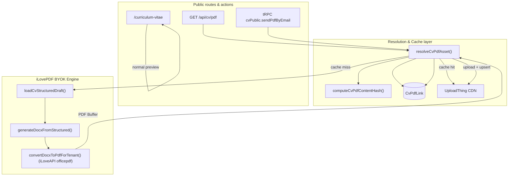

# CV PDF — Technical Guide

This document describes how CV PDF generation, caching, and delivery work in the multi-tenant portfolio. PDF conversions (both DOCX-to-PDF and HTML-to-PDF), UploadThing storage, and portfolio CV email use **each tenant’s own credentials** (Admin → Credentials), not platform env keys — see [`tenant-credentials.md`](./tenant-credentials.md).

The design goals are:

1. **Visual fidelity & ATS compliance** — generate clean, professional ATS resumes formatted with Word document structure and converted to crisp PDF.
2. **Bring Your Own Keys (BYOK)** — each tenant provides their own iLovePDF (iLoveAPI) keys to handle fast, reliable serverless PDF conversions without timeouts or heavy Chromium binaries.
3. **Smart caching** — do not regenerate on every request; invalidate automatically via content hashes when CV content changes.
4. **Zero legacy dependencies** — completely purged fragile Playwright/Chromium serverless invocations and in-place PDF text stamping.

---

## Overview

---

## User flows

### Public download

1. The visitor opens `/curriculum-vitae`.
2. The download button points to `GET /api/cv/pdf?locale={locale}&paginate=0|1`.
3. The route resolves the tenant, calls `resolveCvPdfAsset()`, and:
   - **Cache hit** → streams cached PDF or redirects to the UploadThing URL.
   - **Cache miss** → generates structured ATS DOCX from database, converts to PDF via tenant's iLovePDF API keys, caches to UploadThing, and returns the PDF buffer.
   - **No UploadThing** → streams the generated PDF buffer directly.

### Email delivery

1. The visitor uses the form in `CvPageActions` (client).
2. It calls `cvPublic.sendPdfByEmail` (tRPC).
3. Rate limits are applied (`CvPdfEmailLog`).
4. The same `resolveCvPdfAsset()` runs with `includeBuffer: true`.
5. Resend attaches the PDF and notifies the owner.

### Resume Engine Tailor Export

When tailoring a resume (either in Studio or via uploaded resume):

1. The engine generates the tailored Word document buffer.
2. If the user has iLovePDF configured (`TenantIntegration` `ilovepdf`), it automatically converts the DOCX buffer to PDF via `convertDocxToPdfForTenant`.
3. Both DOCX and PDF formats are stored and attached to the target Job Application in Job Tracker.

---

## Cache layer — `resolveCvPdfAsset`

**File:** `src/features/cv/lib/resolve-cv-pdf-asset.ts`

Single entry point for download and email. All cache logic lives here.

### Algorithm

1. Loads the CV snapshot (`loadCvPreviewSnapshot`).
2. Computes SHA-256 hash across all visible CV entries and locale (`computeCvPdfContentHash`).
3. Queries `db.cvPdfLink` for the active `(userId, locale, paginatePages)`.
4. If cached and hash matches, returns cached file without calling iLovePDF.
5. On cache miss:
   - Loads structured draft via `loadCvStructuredDraft`.
   - Generates ATS DOCX using `generateDocxFromStructured`.
   - Converts DOCX to PDF using `convertDocxToPdfForTenant` via iLovePDF REST API.
   - If tenant has UploadThing configured, uploads the PDF to tenant storage and updates `cvPdfLink`.
   - Returns the resolved PDF buffer.
